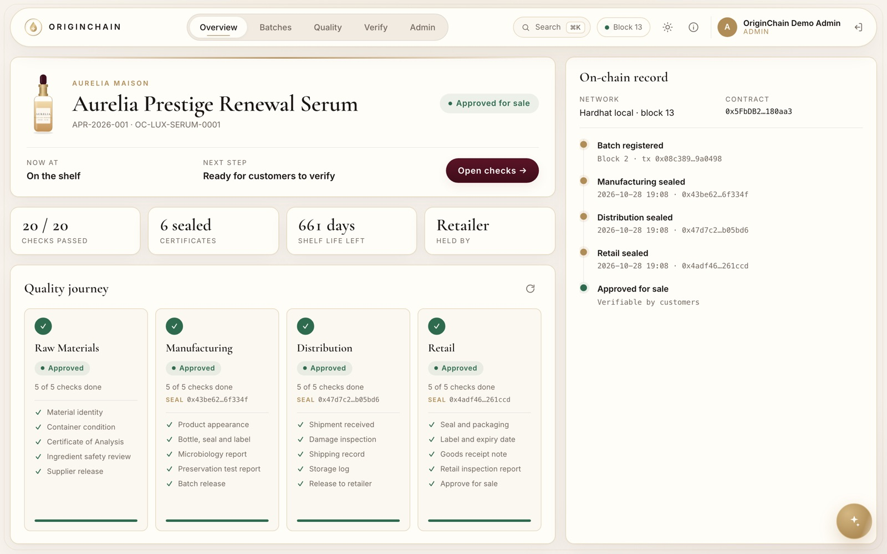
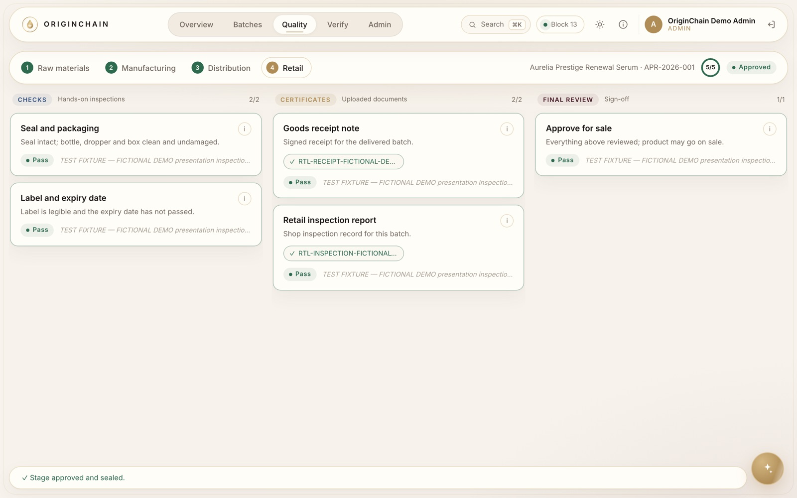
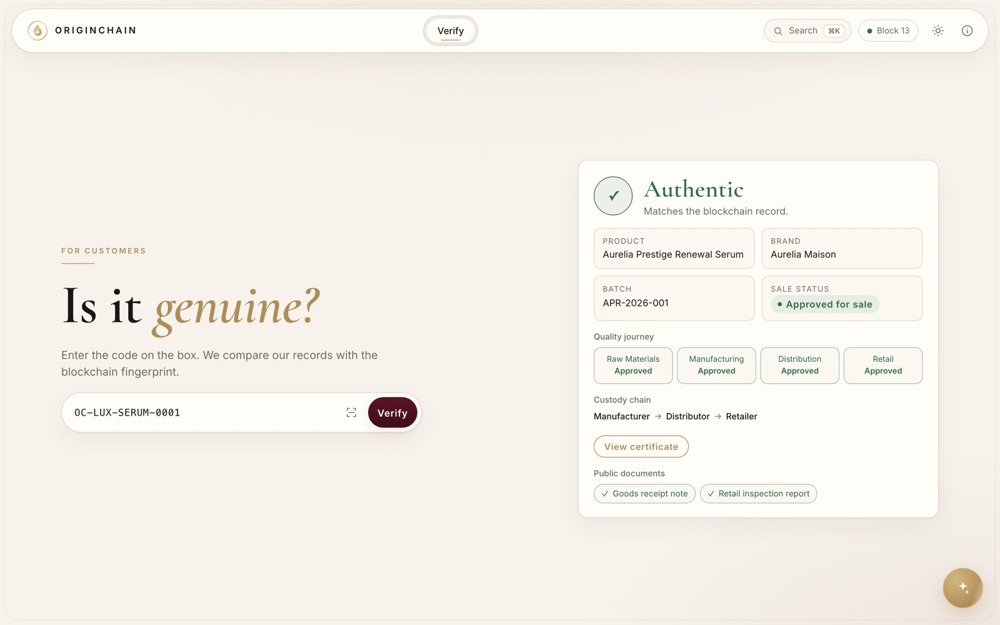

# OriginChain

**Blockchain-backed quality assurance, authentication and supply-chain traceability for luxury cosmetics.**

OriginChain follows one product from raw materials to the shop shelf. Every stage has to pass its quality checks before custody can move on, every approval is sealed on a blockchain, and any customer can check a product's code to see whether it is genuine. Operational records and evidence files stay off-chain; only their fingerprints (Keccak-256 hashes) go on-chain, so a single changed byte is detected.



| Quality gates at every hand-off | Public verification |
|---|---|
|  |  |

## What it does

```text
Raw-material supplier QC → Manufacturer QC → Distributor QC → Retail inspection → Approved for sale
                                                                                       ↓
                                                              Customer verification by code or QR
```

- **Quality gates.** Five checks per stage (inspections, certificates and a final review). One failed check puts the batch on hold, and custody cannot move until it passes.
- **Tamper evidence.** Certificates and approvals are hashed and committed to a Solidity contract. A product whose record no longer matches is flagged as suspicious.
- **Server-enforced access control.** Argon2 password hashing, short-lived JWTs and role checks on every request for five roles: supplier, manufacturer, distributor, retailer and admin.
- **Audit trail.** Every action is attributed to a user and written to an admin-only audit log.
- **Public verification.** Customers see authenticity, provenance and public evidence with no account, and never see internal notes or private data.

## Architecture

```text
Static HTML/CSS/JS ──JWT──▶ FastAPI (auth + RBAC) ──▶ SQLite + evidence files (off-chain)
                                      │
                                      └──▶ Web3.py ──▶ Hardhat local EVM (hashes, ownership, quality commitments)
```

**Stack:** Python, FastAPI, SQLite, Web3.py, Solidity, Hardhat, Argon2, JWT, pytest.

## Quick start

Requires Node.js 22.13+, Python 3.10+ (3.13 recommended) and `uv` or `pip`.

```bash
git clone https://github.com/Aryxzing/OriginChain-Demo.git
cd OriginChain-Demo
uv venv --python 3.13 .venv
uv pip install --python .venv/bin/python -r backend/requirements.lock
cd blockchain && npm ci && npm run compile && cd ..
```

Then, in three terminals:

```bash
cd blockchain && npx hardhat node          # 1. local blockchain
cd blockchain && npm run deploy:local      # 2. deploy the contract
source .venv/bin/activate && uvicorn backend.main:app --reload   # 3. API and interface
```

Open <http://127.0.0.1:8000> (API docs at `/docs`). Demo accounts and a guided walkthrough are in the [full guide](docs/FULL_GUIDE.md#demo-accounts).

## Tests

```bash
PYTHONPATH=. .venv/bin/python -m pytest -q backend/tests   # backend
cd blockchain && npm test                                   # smart contract
```

## Scope

OriginChain is a local, single-machine demonstration. The product, companies and inspection results are fictional; the quality-standard sources are real. It does not claim production readiness, regulatory approval or affiliation with any real brand. The [full guide](docs/FULL_GUIDE.md#security-limitations) lists the security controls that are and aren't implemented.

## Documentation

- [Full guide](docs/FULL_GUIDE.md): domain model, permission matrix, API summary, quality standards, reset and troubleshooting
- [Project report](docs/PROJECT_REPORT.md)
- [Architecture](docs/LUXURY_COSMETICS_ARCHITECTURE.md), [quality sources](docs/LUXURY_COSMETICS_QUALITY_SOURCES.md), [governance and evidence](docs/QUALITY_GOVERNANCE_AND_EVIDENCE.md)

## Team

| Name | Role |
|---|---|
| Durva Waghchaure | Backend Lead & Project Lead |
| Aradhya | Frontend Lead |
| Aryxzing | Blockchain Lead |
| Purvika | AI Lead |

## License

Developed for educational purposes as part of a Bachelor of Engineering project.
